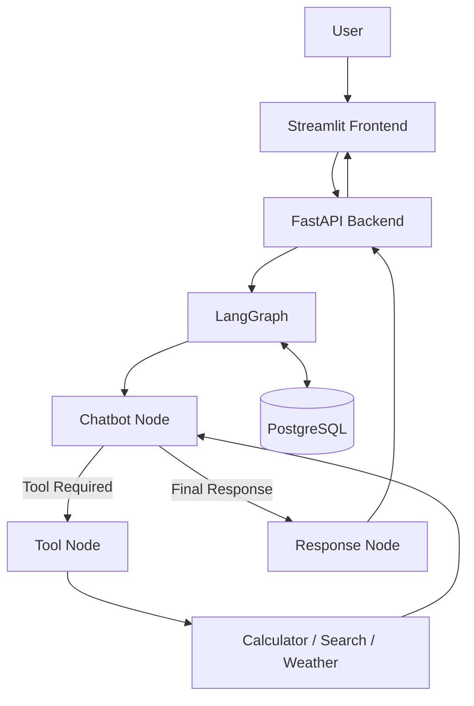

# 🤖 Agentic AI Chatbot

An AI-powered chatbot built with **LangGraph, LangChain, Groq, FastAPI, Streamlit, and PostgreSQL**. It can answer questions, use tools, search the web, retrieve weather information, and perform calculations.

## Features

- **AI Chatbot:** Answers general questions using a Groq language model.
- **Calculator:** Performs mathematical calculations using a dedicated tool.
- **Web Search:** Retrieves information from the internet using Tavily.
- **Weather:** Retrieves current weather information using OpenWeather.
- **Tool Calling:** Automatically selects and executes tools when needed.
- **Conversation Memory:** Stores conversation state using PostgreSQL.
- **Streaming Responses:** Displays tool activity and responses in the Streamlit interface.
- **Conversation Management:** Create, view, switch between, and delete conversations.

## Tech Stack

| Technology | Purpose |
|---|---|
| Python | Core programming language |
| LangGraph | Agent workflow and state management |
| LangChain | LLM and tool integration |
| Groq | Language model inference |
| FastAPI | Backend API |
| Streamlit | Frontend interface |
| PostgreSQL | Conversation state persistence |
| Tavily | Web search |
| OpenWeather | Weather information |

## Architecture



## Project Structure

```text
agentic-chatbot/
├── src/
│   ├── backend_fastapi.py
│   ├── graph.py
│   ├── nodes.py
│   ├── state.py
│   ├── tools.py
│   ├── schemas.py
│   ├── checkpointer.py
│   └── conversation.py
├── .env
├── pyproject.toml
├── uv.lock
├── main.py
└── README.md
```

## Installation

### 1. Clone the repository

```bash
git clone <YOUR_GITHUB_REPOSITORY_URL>
cd agentic-chatbot
```

### 2. Install dependencies

This project uses `uv` for dependency management.

```bash
uv sync
```

### 3. Configure environment variables

Create a `.env` file in the project root:

```env
GROQ_API_KEY=your_groq_api_key
TAVILY_API_KEY=your_tavily_api_key
OPENWEATHER_API_KEY=your_openweather_api_key
DATABASE_URL=your_postgresql_connection_string
```

Use the actual database environment variable expected by your `checkpointer.py` implementation.

Obtain API keys from:

- [Groq](https://console.groq.com/)
- [Tavily](https://tavily.com/)
- [OpenWeather](https://openweathermap.org/api)

**Important:** Never upload your `.env` file or API keys to GitHub. Add `.env` to `.gitignore`.

### 4. Start the backend

```bash
uv run uvicorn src.backend_fastapi:app --reload
```

API documentation: http://127.0.0.1:8000/docs

### 5. Start the frontend

Open a second terminal and run:

```bash
uv run streamlit run <YOUR_STREAMLIT_FILE>.py
```

Replace the filename with your actual Streamlit application filename.

## API Endpoints

| Method | Endpoint | Description |
|---|---|---|
| GET | `/health` | Check API availability |
| POST | `/` | Submit a chat request |
| POST | `/tangi` | Stream chat events |
| GET | `/conversations` | List conversations |
| GET | `/conversations/{thread_id}/history` | Retrieve conversation history |
| DELETE | `/conversations/{thread_id}` | Delete a conversation |

## How It Works

1. The user submits a question through Streamlit.
2. FastAPI receives the request.
3. LangGraph processes the conversation.
4. The chatbot decides whether a tool is required.
5. The Tool Node executes the selected tool.
6. The result returns to the chatbot for further processing.
7. The Response Node prepares the final answer.
8. PostgreSQL checkpoints conversation state for future interactions.

## Future Improvements

- Long-term conversation summarization.
- Improved error handling and rate-limit management.
- More tools and external API integrations.
- Automated testing and monitoring.
- Authentication and production deployment.


