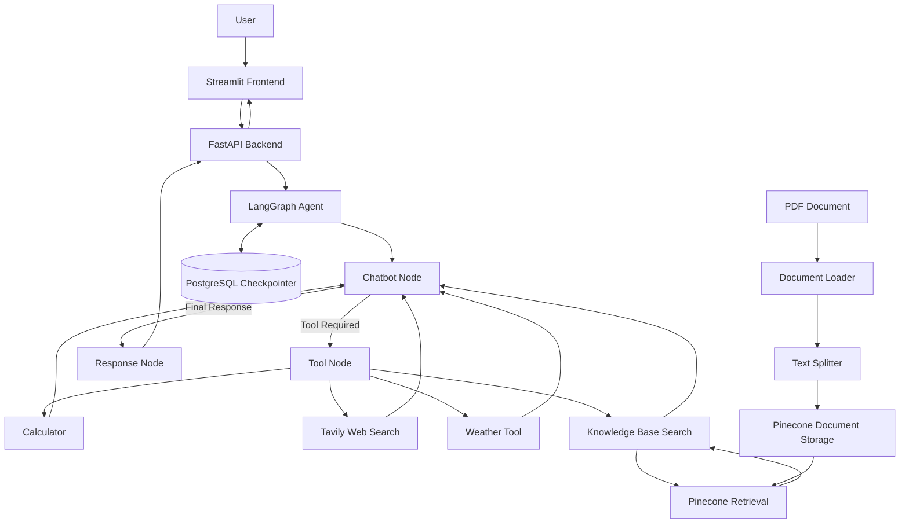

# 🤖 Agentic AI Chatbot

An AI-powered chatbot built with **LangGraph, LangChain, Groq, FastAPI, Streamlit, PostgreSQL, and Pinecone**.

The application combines conversational AI with tool calling, persistent conversation state, streaming responses, and Retrieval-Augmented Generation (RAG). Users can interact with the chatbot, perform calculations, search the web, retrieve weather information, and upload PDF documents to build a searchable knowledge base.

## Features

- **AI Chatbot:** Answers general questions using a Groq-hosted language model.
- **Calculator:** Performs mathematical calculations through a dedicated tool.
- **Web Search:** Retrieves relevant information from the internet using Tavily.
- **Weather Information:** Retrieves weather information using OpenWeather.
- **Agentic Tool Calling:** Uses LangGraph to determine when tools are needed and process their results.
- **PDF Upload:** Uploads PDF documents through the Streamlit interface.
- **Retrieval-Augmented Generation (RAG):** Retrieves relevant document chunks from Pinecone to answer questions about uploaded documents.
- **Integrated Embeddings:** Uses Pinecone's integrated embedding functionality to embed and search document text.
- **Conversation Persistence:** Uses PostgreSQL-backed LangGraph checkpointing to preserve conversation state.
- **Streaming Responses:** Displays response progress and tool activity in the chat interface.
- **Conversation Management:** Create, view, switch between, and delete conversations.
- **REST API:** Exposes chatbot and document-upload functionality through FastAPI.

## Tech Stack

| Technology | Purpose |
|---|---|
| Python | Core programming language |
| LangGraph | Agent workflow, routing, and state management |
| LangChain | Language model integration and document processing |
| Groq | Language model inference |
| FastAPI | Backend API and streaming responses |
| Streamlit | Interactive chat interface |
| PostgreSQL | Persistent conversation state |
| Pinecone | Vector storage and semantic retrieval |
| Tavily | Web search |
| OpenWeather | Weather information |
| PyPDFLoader | PDF text extraction |
| `uv` | Python dependency and project management |

## Architecture



## Project Structure

```text
agentic-chatbot/
├── frontend.py
├── ingest_pdf.py
├── test_retrieval.py
├── test_agent_rag.py
├── src/
│   ├── rag/
│   │   ├── document_loader.py
│   │   ├── text_splitter.py
│   │   ├── embeddings.py
│   │   ├── vector_store.py
│   │   ├── retrieval.py
│   │   └── ingestion.py
│   ├── tools.py
│   ├── graph.py
│   ├── nodes.py
│   ├── state.py
│   ├── backend_fastapi.py
│   ├── checkpointer.py
│   ├── conversation.py
│   └── schemas.py
├── tests/
├── .env
├── .gitignore
├── pyproject.toml
├── uv.lock
└── README.md
```

## Installation and Setup

### 1. Prerequisites

Install the following:

- Python 3.12 or a compatible version supported by the project.
- [`uv`](https://docs.astral.sh/uv/)
- PostgreSQL database
- API credentials for the external services you intend to use
- A Pinecone account and configured index for document retrieval

### 2. Clone the Repository

```bash
git clone <YOUR_GITHUB_REPOSITORY_URL>
cd agentic-chatbot
```

Replace the repository URL with your GitHub repository URL.

### 3. Install Dependencies

Install the project dependencies using `uv`:

```bash
uv sync
```

### 4. Configure Environment Variables

Create a `.env` file in the project root directory.

Add the environment variables required by your implementation:

```env
GROQ_API_KEY=your_groq_api_key
TAVILY_API_KEY=your_tavily_api_key
OPENWEATHER_API_KEY=your_openweather_api_key
DATABASE_URL=your_postgresql_connection_string
PINECONE_API_KEY=your_pinecone_api_key
PINECONE_INDEX_NAME=agentic-chatbot-vectors
```

Ensure the PostgreSQL variable name matches the one used by your checkpointer configuration. Include any additional environment variables required by your implementation.

Obtain credentials from:

- [Groq Console](https://console.groq.com/)
- [Tavily](https://tavily.com/)
- [OpenWeather API](https://openweathermap.org/api)
- [Pinecone](https://www.pinecone.io/)

Configure the Pinecone index with the schema and integrated embedding model expected by `src/rag/vector_store.py`.

**Security:** Never commit API keys, database credentials, or your `.env` file to GitHub. Ensure `.env` is included in `.gitignore`.

### 5. Start the Backend

From the project root, run:

```bash
uv run uvicorn src.backend_fastapi:app --reload
```

The FastAPI backend should be available at:

- API base URL: `http://127.0.0.1:8000`
- Interactive API documentation: `http://127.0.0.1:8000/docs`

Keep this terminal running.

### 6. Start the Frontend

Open a second terminal in the project root:

```bash
uv run streamlit run frontend.py
```

Open the local URL displayed by Streamlit, usually:

`http://localhost:8501`

## Using the Application

### Chat and Tools

1. Open the Streamlit application.
2. Enter a question in the chat input.
3. The LangGraph agent processes the request.
4. When necessary, the agent invokes a registered tool.
5. The tool result returns to the agent for further processing.
6. The final response is streamed to the interface.

### PDF Knowledge Base

1. Open the **Knowledge Base** section in the sidebar.
2. Upload a PDF document.
3. Click **Upload and process PDF**.
4. The FastAPI backend extracts the document text.
5. The text is divided into overlapping chunks.
6. The chunks are stored in Pinecone, which generates embeddings using its integrated embedding model.
7. Ask a question about the uploaded document.
8. The agent uses the knowledge base search tool to retrieve relevant chunks and formulate an answer.

The current implementation uses the `default` Pinecone namespace, so uploaded documents share the same searchable knowledge base.

### Conversation Management

- Create a new chat.
- View previous conversations.
- Switch between conversations.
- Delete conversations with confirmation.
- Continue conversations using persisted LangGraph state.

## API Endpoints

| Method | Endpoint | Description |
|---|---|---|
| GET | `/health` | Check backend availability |
| POST | `/` | Submit a standard chat request |
| POST | `/tangi` | Stream chat events |
| GET | `/conversations` | List saved conversations |
| POST | `/conversations` | Create a conversation |
| GET | `/conversations/{thread_id}/history` | Retrieve conversation history |
| DELETE | `/conversations/{thread_id}` | Delete a conversation |
| POST | `/documents/upload` | Upload and ingest a PDF |

See `/docs` for the request schemas, response formats, and interactive endpoint testing.

## How the Agent Works

1. **Input:** The user submits a question through Streamlit.
2. **API:** FastAPI receives the request and identifies the conversation using its thread ID.
3. **Agent:** LangGraph executes the chatbot node.
4. **Routing:** The agent determines whether a tool is required.
5. **Tool execution:** The Tool Node executes the selected tool.
6. **Iteration:** The tool result returns to the chatbot node for additional reasoning.
7. **Retrieval:** For document-specific questions, the knowledge base tool searches Pinecone for relevant document chunks.
8. **Response:** The response node prepares the final answer.
9. **Persistence:** PostgreSQL stores graph checkpoints so conversation state can be restored.

## Testing

The project includes scripts for validating the document retrieval and agent workflows.

Run the retrieval test:

```bash
uv run python test_retrieval.py
```

Run the agent and RAG integration test:

```bash
uv run python test_agent_rag.py
```

These scripts assume that the required environment variables are configured and the Pinecone index contains the documents used by the tests.

## Current Limitations

- Document retrieval depends on the contents of the configured Pinecone index.
- Uploaded PDFs are stored in a shared namespace rather than being isolated by user or conversation.
- External services may impose API quotas, rate limits, or usage costs.
- The application is configured for local development and requires additional deployment and security configuration before public production use.

## Future Improvements

- Add automated unit and integration test coverage.
- Improve error handling, retries, and rate-limit management.
- Add source citations to document-grounded answers.
- Support document deletion, replacement, and metadata filtering.
- Add user authentication and per-user document isolation.
- Improve conversation titles and history management.
- Add observability, latency tracking, and retrieval evaluation.
- Deploy the application using a production-ready hosting architecture.

## License

Add a license to this repository if you intend to distribute or publish the project for reuse.
